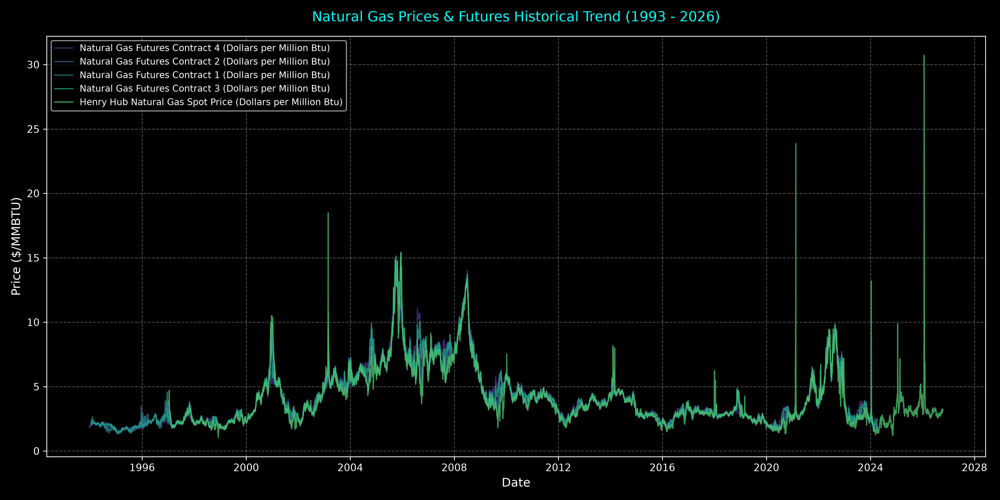
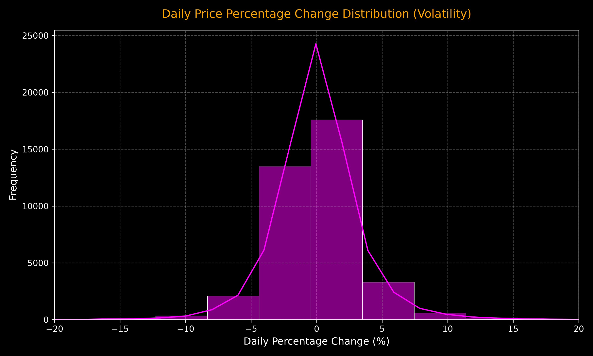

# 🚀 Enterprise Natural Gas ELT & Analytics Pipeline (1993 - 2026)

<p align="center">
  
  
  
  
  
</p>

---

## 🌟 Overview
An **End-to-End Modern Data Engineering & Business Intelligence Pipeline** built to process over **37,000 historical records** of natural gas spot prices and futures contracts (EIA data spanning 1993 to 2026). 

This project simulates a production-grade enterprise workflow: extracting raw market data, staging and transforming it in a cloud data warehouse using **dbt**, performing advanced statistical analysis in **Python & Jupyter Notebooks**, and feeding high-performance analytical views directly into **Power BI**.

---

## 🏗️ Architecture & Tech Stack

| Component | Technology | Description |
| :--- | :--- | :--- |
| **Data Ingestion** | Python (`Requests`, `BeautifulSoup`) | Automated scraping and pulling raw EIA market data. |
| **Cloud Warehouse** | Snowflake (`FINANCE_DB`) | Secure, scalable cloud storage utilizing RAW, STAGING, and ANALYTICS layers. |
| **Transformation** | dbt (Data Build Tool) | Modular SQL models, automated testing, type casting, and window functions. |
| **Data Analysis** | Pandas, NumPy, Seaborn, Matplotlib | Exploratory data analysis, price distribution, and volatility metrics. |
| **Visualization** | Power BI | Interactive executive dashboard powered by customized dbt views. |
| **Version Control** | Git & GitHub | Professional repository management and code documentation. |

---

## ⚙️ Pipeline Workflow

1. **Ingestion Layer:** Raw CSV data is fetched and loaded into Snowflake (`RAW.NATURAL_GAS_PRICES_RAW`).
2. **Staging & Cleaning (`stg_clean`):** Standardizes columns, handles missing values, and ensures data integrity.
3. **Transformation & Modeling (`fct_natural_gas_prices`):** 
   * Extracts temporal dimensions (`PRICE_YEAR`, `PRICE_MONTH`, `PRICE_QUARTER`).
   * Computes daily price movements and percentage changes using advanced SQL window functions (`LAG`).
4. **Analytics & BI Views:** Generates dedicated clean SQL views (`fct_price_trends`, `fct_price_summary`, `fct_price_volatility`, `fct_yearly_trends`) tailored for high-speed Power BI reporting.

---

## 📈 Visual Reports & Market Insights

### 1. Historical Price Trends (1993 - 2026)
*Visualizing long-term price trajectories and market cycles across Henry Hub spot and futures contracts.*
<p align="center">
  
</p>

### 2. Price Volatility & Percentage Change Distribution
*Evaluating daily market fluctuations, risk spread, and frequency distributions.*
<p align="center">
  
</p>

---

## 🛠️ How to Run This Project Locally

1. **Clone the repository:**
   ```bash
   git clone [https://github.com/eldep4667-gif/Gaz__dbt_project.git](https://github.com/eldep4667-gif/Gaz__dbt_project.git)
   cd Gaz__dbt_project